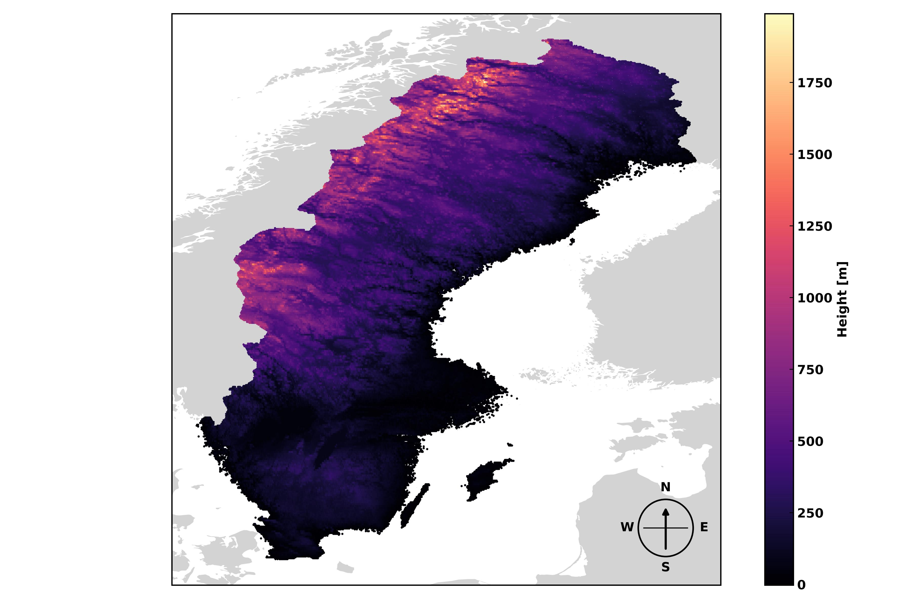
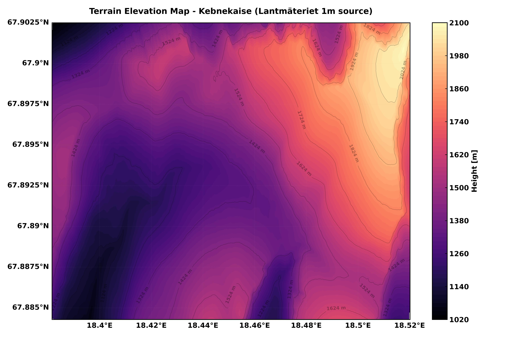

# TerrainData
Program for generating terrain data from Digital Elevation Maps (DEMs).
The main product of this project is the Terrain class model, with the
Region class as the "facilitator" for calling the fetch from available/selected
DEM sources (currently):

- Lantmäteriet
- Copernicus DEM 30m and 90m

and generating the Terrain model from the downloaded source files (tiles).

## Region bounds

There are currently two methods of generating the bounding box for the height model.
These two options are country bounds:
```
region = Region.from_country(country="Sweden")
```



and custom bounds:
```
region = Region.from_bounds(
    west=18.38155,
    east=18.52011,
    south=67.88428,
    north=67.90249
)
```


